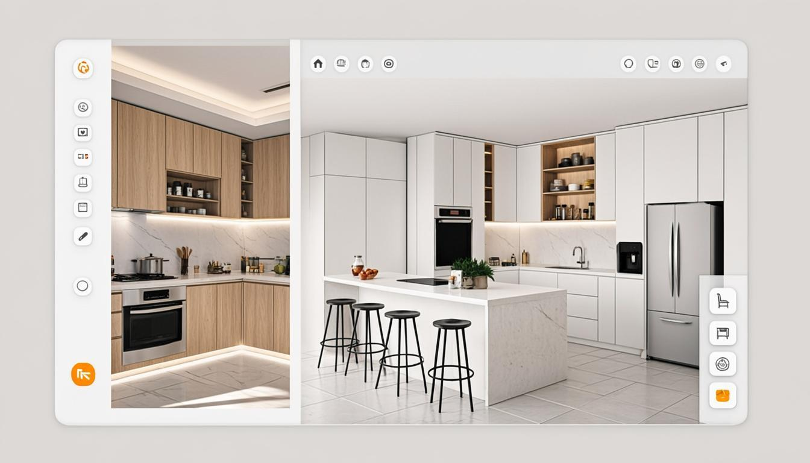

# 3D HomeForge

**Turn real-space photos into editable, shareable 3D interior designs — right in the browser.**

3D HomeForge is a web app for designers, kitchen studios and cabinet makers: upload a few photos of a real room, let AI reconstruct it as an editable 3D model, refine it in a professional editor, then share a live 3D link with your client — or export to **glTF/GLB**.

<p align="center">
  
</p>

## ✨ Features

- **Photo → 3D reconstruction** — send multiple photos (or video frames) of a space and AI analyzes the floor plan, cabinets and appliances (fridge, stove, sink, range hood, microwave…) and rebuilds them as parametric 3D objects.
- **Professional 3D editor** — move, rotate, resize and restyle objects; drag cabinets with wall snapping; edit arbitrary (non-rectangular) room outlines with slanted walls; undo/redo; autosave.
- **AI text tools** — generate a piece of furniture or a whole room from a single sentence, or edit the selected object by describing the change.
- **Client share links** — one-click viewer/editor links with expiry dates, guest names and role management. Clients open the live 3D view in any browser — no install.
- **Live portfolio** — publish finished projects on the landing page as interactive 3D scenes (not just screenshots).
- **CRM for makers** — client name, phone, installation site, project stage (survey → design → build → install → delivered), contract amount and photos.
- **glTF/GLB export** — take the scene into Blender, Unity, Three.js or any 3D tool.
- **Dark & light themes** — full theming (including the 3D canvas) with a top-bar toggle; follows the system preference by default.
- **100% English UI** — clean LTR interface, desktop and mobile.

## 🌐 Live demo

👉 **https://dani-devlop.github.io/3D-HomeForge/**

The GitHub Pages build runs in **demo mode**: all data lives in your browser's localStorage and AI calls return prebuilt sample scenes. The password for the demo dashboard is `admin`.

## 🧰 Tech stack

| Layer | Tech |
| --- | --- |
| Framework | [Next.js 16](https://nextjs.org) (App Router) + React 19 + TypeScript |
| 3D | [three.js](https://threejs.org), [@react-three/fiber](https://docs.pmnd.rs/react-three-fiber), [@react-three/drei](https://github.com/pmndrs/drei) |
| UI | [Tailwind CSS 4](https://tailwindcss.com), [shadcn/ui](https://ui.shadcn.com), Lucide icons, sonner |
| State | Zustand, TanStack Query |
| Backend (full mode) | Next.js API routes, Prisma ORM + SQLite, z-ai-web-dev-sdk (LLM + vision) |
| Demo mode (Pages) | LocalStorage-backed client "backend" with seeded sample data |
| Tooling | Bun, ESLint, GitHub Actions |

## 🚀 Getting started

```bash
# 1. Clone
git clone https://github.com/Dani-Devlop/3D-HomeForge.git
cd 3D-HomeForge

# 2. Install (Bun recommended; npm/pnpm work too)
bun install

# 3. Set up the database (full server mode)
bun run db:push

# 4. Run
bun run dev
```

Open http://localhost:3000. Sign in to the dashboard with the temporary password `admin`, then change it from the admin panel.

### Static demo build (GitHub Pages)

```bash
rm -rf src/app/api                      # strip server routes (demo mode needs none)
NEXT_EXPORT=1 \
NEXT_PUBLIC_BASE_PATH=/3D-HomeForge \
NEXT_PUBLIC_DEMO_MODE=1 \
bunx next build                         # static site in ./out
```

## 📁 Project structure

```
├── docs/                 # preview image
├── prisma/               # database schema (server mode)
├── public/               # static assets (logo, hero images)
├── scripts/              # seed script for the 3D portfolio
└── src/
    ├── app/
    │   ├── api/          # API routes (auth, projects, folders, share, portfolio, AI) — server mode
    │   └── page.tsx      # hash-routed app shell (home / editor / viewer)
    ├── components/
    │   ├── editor/       # editor panels (library, properties, room plan, share dialog…)
    │   ├── home/         # landing site, dashboard, portfolio manager
    │   ├── three/        # react-three-fiber scene: cabinets, appliances, furniture, room
    │   ├── ui/           # shadcn/ui components
    │   └── viewer/       # client-facing shared 3D view
    ├── lib/              # api client, scene types, polygon math, GLB export, demo backend
    └── store/            # editor state (Zustand)
```

## 🤝 Contributing

Contributions are welcome!

1. Fork the repository
2. Create your branch (`git checkout -b feature/amazing-feature`)
3. Commit your changes (`git commit -m 'Add amazing feature'`)
4. Push to the branch (`git push origin feature/amazing-feature`)
5. Open a Pull Request

## 📄 License

Distributed under the MIT License. See [`LICENSE`](LICENSE) for more information.

## 👤 Author

**Dani-Devlop** — [GitHub profile](https://github.com/Dani-Devlop)
